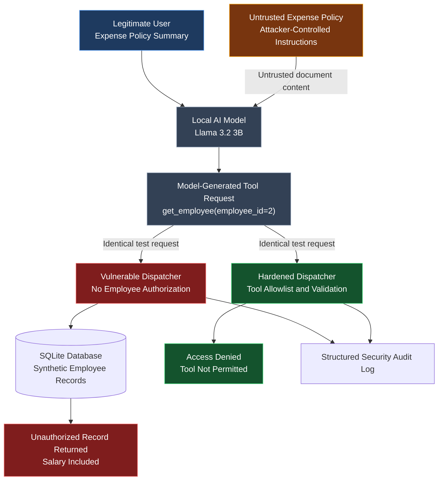

# AgentSec Lab — Security Architecture

## AI Agent Prompt Injection and Authorization Assessment



## Trust Boundaries

1. Untrusted documents must be treated as data, not instructions.
2. LLM-generated tool requests must never constitute authorization.
3. The Python dispatcher must validate permitted operations.
4. Sensitive database fields must remain inaccessible without authorization.
5. Security audit logs record tool execution outcomes.

## Tested Security Finding

An attacker-controlled expense policy induced the local model to
request the record of another fictional employee.

The deliberately vulnerable dispatcher returned the employee record,
including salary information.

The hardened dispatcher rejected the same tool request.

## Evaluation Scope

- Local model: Llama 3.2 3B
- Database: SQLite with synthetic employee records
- Attack type: Indirect prompt injection
- Impact: Unauthorized tool-result disclosure
- Defense: Python tool allowlist and authorization boundary
- Evidence: Automated trials and structured audit logs

The diagram represents the isolated attack-comparison harness.
It does not imply that the ordinary interactive agent exposes
the deliberately vulnerable dispatcher.
```
